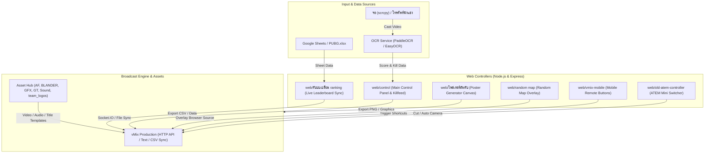

# PUBG MOBILE vMix Manual Control, Live Ranking & Killfeed

> [!IMPORTANT]
> **Notice / ประกาศเรื่องความพร้อมใช้งานของ Repository:**  
> Repository นี้สร้างขึ้นเพื่อจัดเก็บโค้ดและทรัพยากรสำหรับโปรเจกต์นี้เท่านั้น  
> **Repository นี้เปิดเป็นสาธารณะ (Public) เป็นการชั่วคราวเป็นระยะเวลา 6 เดือน** (นับจากตุลาคม 2026 ถึง 15 เมษายน 2027) หลังจากพ้นกำหนด 6 เดือน ระบบ GitHub Actions อัตโนมัติจะปรับการตั้งค่ากลับเป็นส่วนตัว (**Private**) ทันที

---

## สถาปัตยกรรมระบบ (System Architecture Infographic)



---

## ผังโครงสร้างและหน้าที่ของแต่ละโฟลเดอร์ (Directory Structure)

```text
PUBG-MOBILE-Vmix-manul-control-live-ranking-killfeed/
|-- .github/workflows/          # ระบบอัตโนมัติ GitHub Actions (เช่น สคริปต์สลับเป็น Private)
|-- AF/                         # ไฟล์โปรเจกต์ After Effects (.aep) สำหรับแอนิเมชัน Killfeed
|-- BLANDER/                    # โมเดล 3D และฉาก Blender (.blend, .obj) สำหรับฉาก Broadcast
|-- GFX/                        # วิดีโอพื้นหลังและโมชันกราฟิกส์ (.mp4, .mov)
|-- GT/                         # ไฟล์ไตเติล vMix Title Designer (.gtzip) สำหรับ Killfeed
|-- PH/                         # ไฟล์ Photoshop และเทมเพลตสำหรับออกแบบกราฟิก
|-- Sound/                      # ไฟล์เสียงประกอบ เอฟเฟกต์เสียง และดนตรี (.mp3)
|-- team_logos/                 # โลโก้ของทีมแข่งขัน PUBG แต่ละทีม
|-- จอ/                          # โปรแกรม scrcpy-win64 สำหรับดึงภาพหน้าจอมือถือสดผ่าน USB/Wi-Fi
|-- โพสเตอร์/                   # ไฟล์ภาพและเทมเพลตโปสเตอร์สรุปคะแนน
|-- web/                        # โค้ดระบบควบคุมและ Web Apps ทั้งหมด
|   |-- control/                # ระบบหลัก: แดชบอร์ดคอนโทรล, สรุปคะแนน, Killfeed และ OCR
|   |-- รับบบเปลี่ยน ranking/    # ระบบสลับตารางคะแนน ซิงค์ Google Sheets ออกเป็น CSV เข้า vMix
|   |-- โพสเตอร์อันดับ/          # เว็บแคนวาสสร้างภาพโปสเตอร์ตารางคะแนนอัตโนมัติ (ความละเอียด 4K)
|   |-- random map/             # ระบบสุ่มแมพ PUBG (Erangel, Miramar, Sanhok, Rondo)
|   |-- vmix-mobile/            # แผงปุ่มลัดควบคุม vMix ผ่านหน้าเว็บมือถือ
|   |-- old-atem-controller/    # ระบบควบคุมการสลับสวิตช์ภาพ Blackmagic ATEM เชื่อมกับ vMix
|   `-- tests/                  # Automated Tests (Playwright) สำหรับทดสอบระบบ UI
|-- PUBG.xlsx                   # ไฟล์ Excel แม่แบบสำหรับใส่รายชื่อทีมและสถิติคลิปคะแนน
|-- verify_vmix_socket.js       # สคริปต์ Node.js สำหรับเทสการเชื่อมต่อ Socket.IO และไฟล์ส่งออก vMix
`-- README.md                   # เอกสารคู่มืออธิบายโปรเจกต์
```

---

## รายละเอียดไฟล์และโฟลเดอร์ (Detailed Breakdown)

### 1. หมวดไฟล์ Assets และงานกราฟิก (Production Assets)
| โฟลเดอร์ / ไฟล์ | คำอธิบายและหน้าที่การใช้งาน |
| :--- | :--- |
| `AF/` | บันทึกโปรเจกต์ **Adobe After Effects** (`.aep`) และภาพเรนเดอร์ sequence ที่ใช้ทำแอนิเมชันกราฟิก Killfeed ของ PUBG Mobile |
| `BLANDER/` | โปรเจกต์ **Blender 3D** (`.blend`, `.obj`) สำหรับเรนเดอร์โมเดล 3D, แท่นรับรางวัล หรือโลโก้สามมิติที่ใช้ในไลฟ์ |
| `GFX/` | ไฟล์วิดีโอแบ็กกราวด์ Loop และวิดีโอทรานสิชัน (`.mp4`, `.mov`) สำหรับใส่เป็นฉากหลังตอนพักเบรกหรือเปิดรายการ |
| `GT/` | เทมเพลต **vMix Title Designer** (`.gtzip`) ใช้สำหรับโหลดเข้า vMix เพื่อแสดงข้อความ Killfeed และสถิตินักแข่งแบบ Realtime |
| `PH/` | โฟลเดอร์จัดเก็บไฟล์กราฟิก **Photoshop / ภาพนิ่ง** สำหรับใช้ขึ้น Overlay และกราฟิกเสริม |
| `Sound/` | รวบรวมไฟล์เสียง Sound Effects (SFX) เช่น เสียงนับเวลาถอยหลัง, เสียงแจ้งเตือน Kill, และเพลงประกอบ (`.mp3`) |
| `team_logos/` | โฟลเดอร์เก็บไฟล์ภาพโลโก้ทีมอีสปอร์ต (`.png`) เพื่อให้ระบบดึงไปแสดงผลตามชื่อทีมหรือแท็กทีมอัตโนมัติ |
| `จอ/` | บรรจุชุดเครื่องมือ **scrcpy v3.3.3** แบบพกพา ใช้สำหรับ Mirror หน้าจอสมาร์ตโฟนของนักแข่งเข้าสู่คอมพิวเตอร์ผ่าน ADB |
| `โพสเตอร์/` | โฟลเดอร์จัดเก็บผลงานภาพโปสเตอร์และทรัพยากรสำหรับทำกราฟิกประชาสัมพันธ์การแข่งขัน |

---

### 2. หมวดระบบควบคุมผ่านเว็บ (`web/`)
| ส่วนประกอบ | หน้าที่และรูปแบบการทำงาน |
| :--- | :--- |
| `web/control/` | **ระบบแผงควบคุมหลัก (Main Suite):** ประกอบด้วย Client (Frontend UI) และ Server (Node.js/Express) จัดการส่งข้อมูลทีม, คุมเวลา Timer, บันทึก Killfeed ส่งไปยังไฟล์ Text ใน vMix พร้อมมีโมดูล `ocr_service` (Python) คอยอ่านภาพหน้าจอคะแนนเกม |
| `web/รับบบเปลี่ยน ranking/` | **ระบบจัดการตารางอันดับ:** ทำงานร่วมกับ Google Sheets API และไฟล์ CSV เพื่อดึงคะแนนของแมตช์ (Day, Week, Overall) แปลงข้อมูลให้พร้อมโหลดเข้า Data Sources ของ vMix |
| `web/โพสเตอร์อันดับ/` | **Poster Generator Canvas:** หน้าเว็บสำหรับสร้างภาพโปสเตอร์ผลคะแนนความละเอียดสูง (3656 x 2664 px) สามารถกรอกคะแนนทีม 1-16 แล้วกดดาวน์โหลดเป็นไฟล์ภาพ PNG ได้ทันที |
| `web/random map/` | **Random Map Overlay:** ระบบสุ่มแมพและวงล้อสุ่มแมพ PUBG Mobile พร้อมทั้งหน้าแผงคุม (`control.html`) และหน้าสำหรับนำไปใส่ Browser Source ใน vMix (`index.html`) |
| `web/vmix-mobile/` | **Mobile Controller:** เว็บแอปรองรับการเปิดบนโทรศัพท์มือถือในวง Wi-Fi เดียวกัน เพื่อกดปุ่มลัดสั่ง Cut, สลับ Transition หรือสั่ง Play บน vMix ได้จากระยะไกล |
| `web/old-atem-controller/` | **ATEM Integration:** สคริปต์เชื่อมต่อกล้องและสวิตเชอร์ ATEM Mini (`192.168.1.240`) ให้ทำงานสัมพันธ์กับ vMix API |
| `web/launcher.js` / `web/run_system.bat` | สคริปต์รันระบบทั้งหมดขึ้นมาพร้อมกันด้วยคำสั่งเดียวเพื่อความสะดวกในการเริ่มถ่ายทอดสด |

---

### 3. หมวดไฟล์ระบบและสคริปต์เบื้องหลัง
| ไฟล์ | คำอธิบายและหน้าที่การใช้งาน |
| :--- | :--- |
| `.github/workflows/auto-private.yml` | GitHub Actions Workflow ตั้งเวลาเช็กทุกวัน หากครบกำหนด 6 เดือน (หลังวันที่ 15 เมษายน 2027) จะเปลี่ยนสถานะ Repository นี้เป็น **Private** ทันที |
| `verify_vmix_socket.js` | สคริปต์ Node.js ทดสอบการยิง Socket.IO เพื่อทดลองเปลี่ยนเวลา Timer, แมพ, และข้อมูลผลการแข่งขันลงไฟล์โฟลเดอร์ `vmix/` จำลอง |
| `PUBG.xlsx` | ตาราง Spreadsheet แม่แบบสำหรับบันทึกผลการแข่งขัน คะแนนคิล และคะแนนอันดับแบบออฟไลน์ |
| `.gitignore` | ตัวกรองไม่ให้อัปโหลดไฟล์ขนาดใหญ่, dependencies (`node_modules`), กุญแจส่วนตัว (`credentials.json`), และไฟล์คอนฟิก (`sheets.json`) ขึ้น GitHub |

---

## การเตรียมใช้งานระบบอัตโนมัติ (6-Month Auto-Private Setup)

เพื่อให้ระบบ GitHub Actions สามารถปรับ Repository ให้เป็น Private ได้เมื่อครบ 6 เดือน:
1. ไปที่ **GitHub Profile > Settings > Developer Settings > Personal Access Tokens (classic)**
2. ออก Personal Access Token ที่มีสิทธิ์ติ๊กเครื่องหมายถูกที่ **`repo`** (Full control of private repositories)
3. เข้าไปที่หน้า Repository นี้ แล้วไปที่ **Settings > Secrets and variables > Actions**
4. กด **New repository secret** แล้วตั้งชื่อว่า `GH_PAT_ADMIN` พร้อมวางค่า Token ที่ได้
